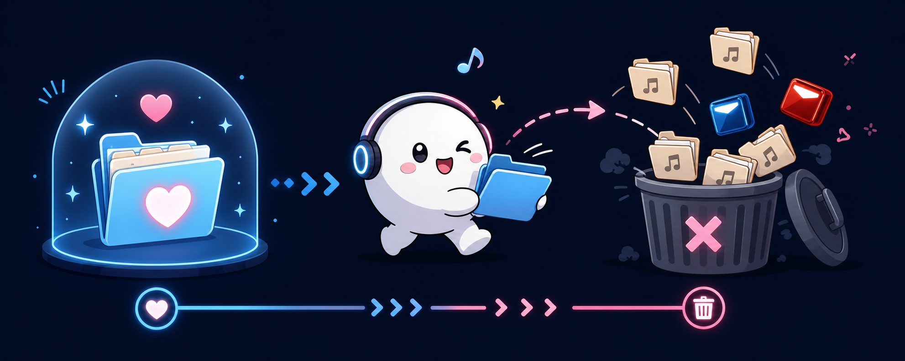

# beatsaber-keep-favorites

[한국어 README](README.ko.md)

- [Download the latest release](https://github.com/MTGVim/beatsaber-keep-favorites/releases/latest)
- [Download the nightly prerelease](https://github.com/MTGVim/beatsaber-keep-favorites/releases/tag/nightly)
- [View CI runs](https://github.com/MTGVim/beatsaber-keep-favorites/actions)

A repository for **keeping only favorite custom songs and cleaning up the rest** on Quest Beat Saber.

Current direction: **mod-first**, while **preserving the CLI track**.
- Primary implementation: an in-game Beat Saber mod with scan/delete UI
- Preserved track: a CLI / dry-run tool that uses the same business logic

## Currently confirmed facts

### Favorites storage location
- Quest Beat Saber favorites are stored in `PlayerData.dat`
- Confirmed pull path:
  - `/sdcard/Android/data/com.beatgames.beatsaber/files/PlayerData.dat`
- JSON key:
  - `localPlayers[0].favoritesLevelIds`

### Candidate custom song paths
- `/sdcard/ModData/com.beatgames.beatsaber/Mods/SongCore/CustomLevels`
- `/sdcard/ModData/com.beatgames.beatsaber/Mods/SongLoader/CustomLevels`
- WIP:
  - `/sdcard/ModData/com.beatgames.beatsaber/Mods/SongCore/CustomWIPLevels`
  - `/sdcard/ModData/com.beatgames.beatsaber/Mods/SongLoader/CustomWIPLevels`

### SongCore cache
- Cache file:
  - `/sdcard/ModData/com.beatgames.beatsaber/Mods/SongCore/CachedSongData.json`
- The cache contains `path -> sha1` data that can help map song folders to favorite hashes

## Collected samples
- `tmp/PlayerData.dat`
- `tmp/CachedSongData.json`

## Current mod behavior
1. Read `favoritesLevelIds` from `PlayerData.dat`
2. Resolve `song path -> sha1` using `CachedSongData.json` or SongCore runtime data
3. Decide keep/delete using `custom_level_<SHA1>`
4. Show the scan result in the in-game UI with counts and status text
5. Only delete non-favorite song folders after explicit user confirmation

## Safety principles
- Never delete automatically on startup or scan
- Back up `PlayerData.dat` before a real delete
- Run only while Beat Saber is fully closed
- Delete entire **song folders**, not individual files

## Tracks
- `mod/`: in-game Beat Saber scan/delete mod implementation
- `cli/`: external dry-run / analysis / backup CLI track
- `docs/plans/`: implementation planning documents
